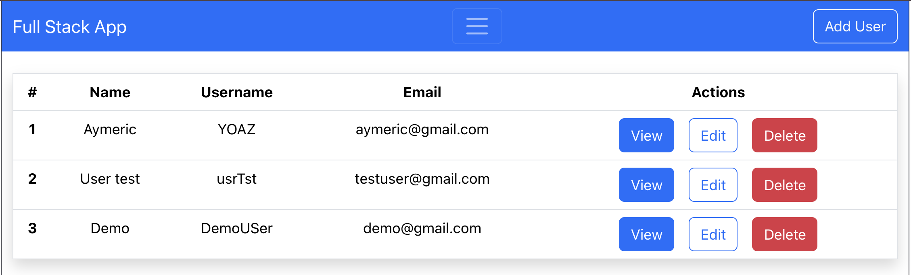
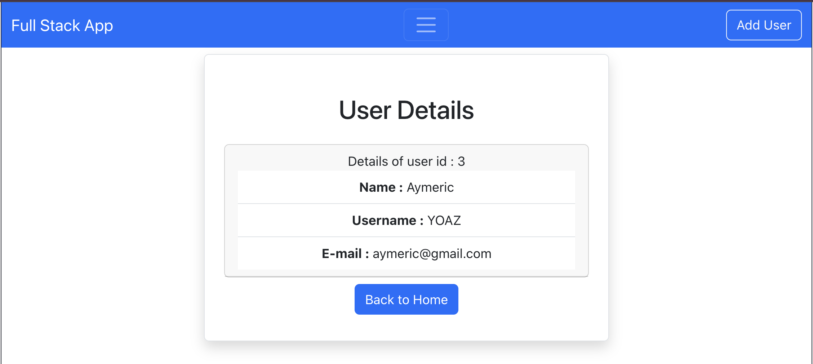
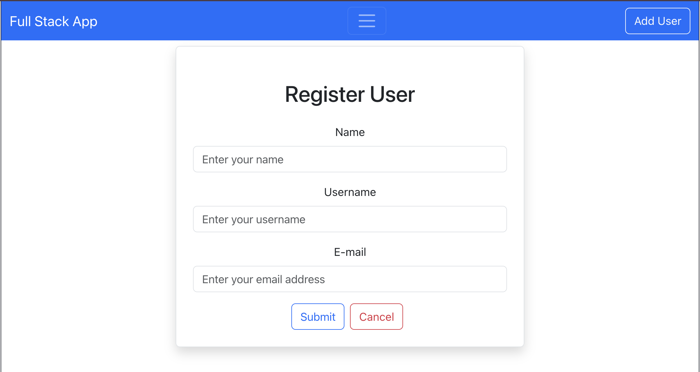

# structuredContact

Application web full stack de gestion d'utilisateurs (CRUD) : un backend **Spring Boot** exposant une API REST connectée à **MySQL**, et un frontend **React** (Vite) qui la consomme.

## Aperçu

### Page d'accueil : liste des utilisateurs


### Page « View » : détails d'un utilisateur


### Page « Add User » : ajout d'un utilisateur


## Fonctionnalités

- Lister tous les utilisateurs
- Consulter le détail d'un utilisateur
- Ajouter un utilisateur
- Modifier un utilisateur
- Supprimer un utilisateur
- Gestion d'erreur `404` si l'utilisateur n'existe pas (`UserNotFoundException`)

## Stack technique

| Couche | Technologies |
|---|---|
| Backend | Java 25, Spring Boot 4.1, Spring Data JPA, Maven |
| Base de données | MySQL |
| Frontend | React 19, Vite, React Router, Axios, Bootstrap 5 |

## Structure du projet

```
structuredContact/
├── backend/     # API REST Spring Boot
├── frontend/    # Application React (Vite)
└── docs/
    └── screenshots/   # Captures d'écran du README
```

## Prérequis

- JDK 25
- Node.js (LTS) et npm
- MySQL 8 en local sur le port `3306`

## Installation et lancement

### 1. Base de données

Créer la base MySQL :

```sql
CREATE DATABASE fullstackdb;
```

Les tables sont créées automatiquement au démarrage (`spring.jpa.hibernate.ddl-auto=update`).

### 2. Backend (port 8080)

Vérifier les identifiants MySQL dans `backend/src/main/resources/application.properties` :

```properties
spring.datasource.url=jdbc:mysql://localhost:3306/fullstackdb
spring.datasource.username=root
spring.datasource.password=root
```

Puis lancer l'API :

```bash
cd backend
./mvnw spring-boot:run
```

### 3. Frontend (port 5173)

```bash
cd frontend
npm install
npm run dev
```

L'application est disponible sur http://localhost:5173

> Le backend autorise uniquement l'origine `http://localhost:5173` (CORS).

## API REST

| Méthode | Route | Description |
|---|---|---|
| `GET` | `/users` | Liste tous les utilisateurs |
| `GET` | `/user/{id}` | Récupère un utilisateur par son id |
| `POST` | `/user` | Crée un utilisateur |
| `PUT` | `/user/{id}` | Modifie un utilisateur |
| `DELETE` | `/user/{id}` | Supprime un utilisateur |

Exemple de corps pour `POST /user` et `PUT /user/{id}` :

```json
{
  "name": "Jean Dupont",
  "username": "jdupont",
  "email": "jean.dupont@example.com"
}
```

## Routes du frontend

| Route | Page |
|---|---|
| `/` | Liste des utilisateurs |
| `/adduser` | Formulaire d'ajout |
| `/viewuser/:id` | Détails d'un utilisateur |
| `/edituser/:id` | Formulaire de modification |

## Auteur

Aymeric YAPI : [@Y0AZ](https://github.com/Y0AZ)
